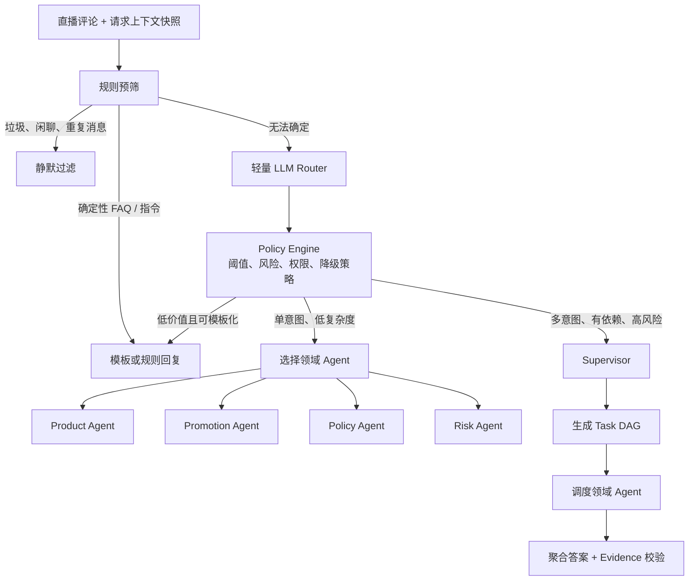

对，最合理的架构是：

> 固定规则负责“能确定处理的场景”，轻量 LLM Router负责“价值、意图、复杂度和执行模式分类”，Policy Engine 根据分类结果做最终路由。单 Agent 场景由 Router/Policy Engine直接选择领域 Agent；只有复杂多意图请求才进入 Supervisor，由 Supervisor拆解任务DAG并调度多个Agent。

核心原则是：Router决定“走哪条执行链路”，Supervisor决定“复杂任务怎么执行”。



## 1. 规则层具体做什么

规则层应该只处理高精度、低歧义的判断，避免把复杂语义硬编码进去。

典型规则包括：

- 垃圾、纯表情、重复刷屏、过短消息。
- 明确的低价值互动，例如“hello”“主播好漂亮”。
- 确定性指令，例如“关注主播”“商品链接在哪”。
- 高风险强制升级，例如包含法律投诉、歧视、安全事故等关键词。
- 基础上下文校验，例如市场、商品或语言信息缺失。
- 限流、黑名单和重复请求合并。

规则输出可以是：

```json
{
  "decision": "PASS_TO_ROUTER",
  "matched_rules": [],
  "risk_flags": [],
  "normalized_text": "这件商品在法国有折扣吗，退货政策是什么？"
}
```

规则层不适合判断“这是一个还是两个隐含意图”“是否需要多工具协作”，这些交给轻量 LLM。

## 2. 轻量 Router 应该输出什么

Router不应该只输出 `single_agent` 或 `multi_agent`。至少应提供下面这些结构化结果：

```json
{
  "value_level": "high",
  "intents": [
    {
      "type": "promotion_query",
      "confidence": 0.96
    },
    {
      "type": "return_policy_query",
      "confidence": 0.93
    }
  ],
  "complexity": {
    "level": "complex",
    "reason_codes": [
      "MULTI_INTENT",
      "CROSS_DOMAIN",
      "MULTI_TOOL_REQUIRED"
    ]
  },
  "recommended_mode": "multi_agent",
  "candidate_agents": [
    "promotion_agent",
    "policy_agent"
  ],
  "risk_level": "medium",
  "required_context": [
    "market",
    "product_id",
    "customer_region"
  ],
  "confidence": 0.94
}
```

推荐Router输出以下维度：

| 字段 | 用途 |
|---|---|
| `value_level` | 是否值得回复 |
| `intents` | 多标签意图识别 |
| `complexity` | 判断执行难度 |
| `recommended_mode` | template、single-agent或multi-agent |
| `candidate_agents` | 候选领域能力 |
| `risk_level` | 是否强制升级或转人工 |
| `required_context` | 检查执行所需信息是否齐全 |
| `confidence` | 低置信度时升级链路 |

但是，Router的结果不应该直接触发工具调用。最好增加一个确定性的Policy Engine，根据成本、风险和置信度作最终决定。

## 3. 单 Agent 链路要不要判断走哪个 Agent？

要。

如果单Agent链路不经过Supervisor，那么Router必须输出意图或候选Agent，由Policy Engine完成最终选择：

```text
promotion_query → Promotion Agent
product_query   → Product Agent
logistics_query → Logistics Agent
return_query    → Policy Agent
risk_query      → Risk Agent
```

更准确的说法不是“Router直接选择Agent实例”，而是：

> Router识别领域能力，Policy Engine根据Agent Registry把能力映射到具体Agent。

例如：

```json
{
  "execution_mode": "single_agent",
  "capability": "return_policy",
  "agent_profile": "policy_agent_v2"
}
```

这样可以将语义识别和运行时配置解耦。以后替换Agent版本、模型或工具集合，不需要重新训练Router。

单Agent不是只能调用一个工具，而是由一个Agent独立完成整个请求：

```text
用户问题
  → Policy Agent
  → 查询退货政策工具
  → 查询市场信息工具
  → 生成带证据的答案
```

“单Agent”和“单工具”不是一回事。

## 4. Router是否承担了部分Supervisor职责？

从广义上说，它承担了一级编排职责；但在系统边界上，建议将两者明确分开。

### Router负责：Admission & Dispatch

回答以下问题：

- 这条消息是否值得处理？
- 属于什么意图？
- 是简单还是复杂？
- 走模板、单Agent还是Multi-Agent？
- 单Agent时需要哪种领域能力？
- 是否因为高风险或低置信度而升级？

### Supervisor负责：Planning & Orchestration

回答以下问题：

- 原问题应该拆成哪些子任务？
- 子任务之间有什么依赖？
- 哪些可以并行？
- 每个任务交给哪个Agent？
- 上游结果如何传递给下游？
- 某个任务失败后重试、降级还是终止？
- 所有用户意图是否都已覆盖？

因此可以用一句话区分：

> Router做粗粒度执行路径选择，Supervisor做细粒度任务规划与调度。

## 5. Multi-Agent链路中Supervisor只负责拆DAG吗？

拆DAG是它最重要的职责，但通常还要负责以下内容：

1. 任务规划

```json
{
  "tasks": [
    {
      "id": "t1",
      "type": "get_product",
      "agent": "product_agent",
      "depends_on": []
    },
    {
      "id": "t2",
      "type": "get_promotion",
      "agent": "promotion_agent",
      "depends_on": ["t1"]
    },
    {
      "id": "t3",
      "type": "get_return_policy",
      "agent": "policy_agent",
      "depends_on": []
    }
  ]
}
```

2. 依赖感知调度

`t1`和`t3`可以并行，`t2`等待`t1`拿到商品信息。

3. Agent选择

Router给出的`candidate_agents`只是提示。Supervisor根据拆出的具体任务确定最终Agent。

4. 状态管理

记录任务处于：

```text
PENDING → RUNNING → SUCCEEDED / FAILED / DEGRADED
```

5. 局部失败处理

例如优惠查询超时，不应该让退货政策查询结果一起丢失。

6. 完整性检查

检查原始问题中的每个意图是否都有对应结论。

7. 汇总控制

Supervisor可以调度专门的Answer Composer，但最好不要让它自己重新编造事实。最终事实必须来自Agent输出和Evidence Store。

## 6. Router和Supervisor之间如何避免职责重复

推荐这样的权威边界：

| 决策 | 权威组件 |
|---|---|
| 是否过滤 | Rule Engine / Policy Engine |
| 回复价值 | Router |
| 初步意图 | Router |
| 单Agent还是Multi-Agent | Policy Engine |
| 单Agent领域 | Router + Agent Registry |
| Multi-Agent子任务 | Supervisor |
| 子任务依赖关系 | Supervisor |
| 每个子任务最终Agent | Supervisor |
| 工具权限 | Tool Gateway |
| 证据有效性 | Evidence Validator |
| 最终回答完整性 | Supervisor / Answer Validator |

Router识别出的意图可以传给Supervisor，但只是`routing_hints`，不能代替Supervisor重新分析：

```json
{
  "request": {
    "text": "法国有折扣吗，退货的时候运费谁出？",
    "context_snapshot_id": "ctx_123"
  },
  "routing_hints": {
    "intents": [
      "promotion_query",
      "return_policy_query"
    ],
    "candidate_agents": [
      "promotion_agent",
      "policy_agent"
    ],
    "reason_codes": [
      "MULTI_INTENT",
      "CROSS_DOMAIN"
    ]
  }
}
```

Supervisor可以接受、修正或补充这些意图。

## 7. 推荐的复杂度判定标准

不要让轻量LLM凭感觉输出“简单/复杂”。应定义明确特征。

走单Agent：

- 单一主要意图。
- 属于单一业务领域。
- 不存在跨Agent依赖。
- 一个Agent拥有所需的全部工具权限。
- 不需要规划、比较或条件推理。
- 风险等级较低。

走Multi-Agent：

- 多个独立意图。
- 跨商品、优惠、政策、税务等领域。
- 存在任务依赖。
- 需要多个权限隔离的工具。
- 需要比较多个来源或市场。
- 需要并行查询以降低延迟。
- 单Agent上下文或工具集合会过大。
- 高风险结论需要独立验证。

例如：

```text
“这件衣服还有M码吗？”
→ 单意图、单领域
→ Product Agent
```

```text
“这件衣服在法国有优惠吗？”
→ 通常仍可由 Promotion Agent 单独处理
→ Promotion Agent内部调用商品和优惠工具
```

```text
“法国和德国哪个更便宜？税费分别是多少，退货政策有什么区别？”
→ 跨市场、多意图、多数据源、可并行
→ Supervisor + Multi-Agent
```

## 8. 最推荐的最终架构

可以将系统分成四个平面：

```text
接入与治理平面
  Context Snapshot、鉴权、限流、去重

决策平面
  Rule Engine → Lightweight Router → Policy Engine

执行平面
  Template Executor
  Single Domain Agent
  Supervisor → Task DAG → Domain Agents

可信与观测平面
  Tool Gateway、Evidence Store、Tracing、Evaluation
```

最重要的是在Router和Policy Engine之间分工：

- Router是概率模型，负责理解语义。
- Policy Engine是确定性代码，负责真正的执行决策。

例如：

```python
if route.risk_level == "critical":
    mode = "human_review"
elif route.confidence < 0.75:
    mode = "multi_agent"
elif len(route.intents) == 1 and route.complexity.level == "simple":
    mode = "single_agent"
elif route.value_level == "low":
    mode = "template"
else:
    mode = "multi_agent"
```

这样面试时可以非常清晰地总结：

> 我们采用“规则预筛＋轻量语义Router＋确定性Policy Engine”的三级路由。Router负责价值、多标签意图和复杂度识别；Policy Engine结合置信度、风险与成本预算决定执行模式。简单单意图请求由Agent Registry直接分发给领域Agent，不经过Supervisor；复杂多意图请求进入Supervisor，由它生成任务DAG、执行依赖调度、处理局部失败并校验回答完整性。这样避免了所有请求都承担Supervisor的规划成本，同时保持复杂任务的可控性。